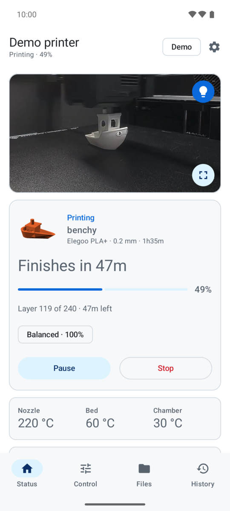
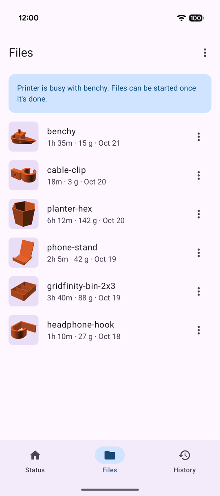
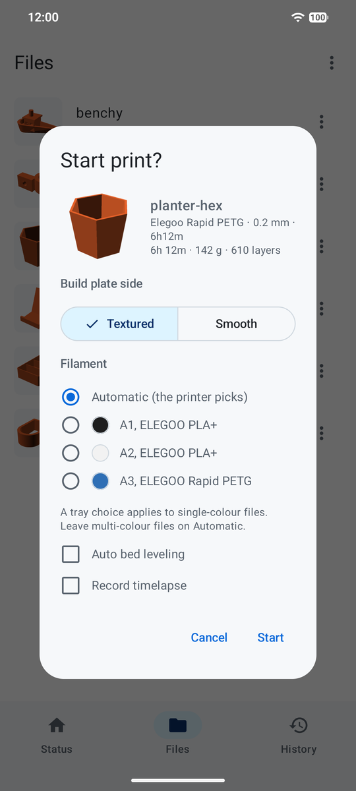

# Centauri

A native Android app to watch and control an **Elegoo Centauri Carbon** 3D printer over your local
network. No cloud, no account, no WebView: the app talks to the printer directly using the same
local protocol (SDCP) the printer's own web interface uses.

> Unofficial app, not affiliated with or endorsed by Elegoo. "Elegoo" and "Centauri Carbon" are
> trademarks of their owner.

<!-- Light or dark screenshots, following the reader's GitHub theme. -->
| Status | Files | Start a print |
|---|---|---|
| <picture><source media="(prefers-color-scheme: dark)" srcset="docs/screenshots/status.png"></picture> | <picture><source media="(prefers-color-scheme: dark)" srcset="docs/screenshots/files.png"></picture> | <picture><source media="(prefers-color-scheme: dark)" srcset="docs/screenshots/start.png"></picture> |

Screenshots are from the built-in demo mode, so you can try the app without a printer too.

## Features

- **Live status**: progress, finish time ("in 42 min", "tomorrow 07:10"), layer, temperatures, speed, the
  current print's thumbnail; clear Paused, Error (with the reason and what to do) and Preheat → Level → Print
  states; "Print again" for your last jobs while idle
- **Camera**: live view (tap to pause) with pinch zoom, fullscreen landscape with job info, save a frame to Pictures,
  chamber light toggle
- **Control** tab: temperatures (steppers and material presets), print speed, fans, light, presets
  (built-in and your own), homing
- **Files**: browse the printer's storage, start a print from a bottom sheet (plate side, auto-leveling,
  timelapse, remembered), multi-select delete, free space
- **History**: past prints with thumbnails, duration and outcome (completed, stopped, failed with the reason),
  filters and totals; print again or remove entries
- **Notifications**: ongoing progress with Pause/Resume, Light and Stop (confirmed in the app) in the shade, an
  Android 16 Live Update, and alerts when a print finishes, pauses, stops or fails, with the reason. Every
  type has its own switch (Settings → Notifications), plus optional "minutes left" and first-layer snapshot
  alerts
- **Home screen**: two widgets, a Quick Settings tile for the chamber light, and launcher shortcuts
  (Status, Camera, Files, Print again)
- **Finds the printer again** when its IP address changes
- **Demo mode**: try every screen with a simulated printer and its scenarios (printing, paused, error,
  almost done…), no hardware needed
- GitHub colors or Material You, light or dark following the system
- **Tablets and foldables**: navigation rail, camera beside the status, list and detail side by side
- **Languages**: English, Dutch and Greek, with an in-app picker
- **Check for updates** in About, against this repository's releases (only when you tap it)
- **Labs** (Settings (gear) → Labs): features built from other clients' payloads but not yet tried on a real
  printer: skip preheating / stop filament feed, choosing the Canvas tray to print from, USB storage and
  timelapses. They stay off until you switch them on.

## Requirements

- Android 13 (API 33) or newer
- A Centauri Carbon (the original; the Centauri Carbon 2 uses a different protocol) on the same
  network as the phone. Away from home, a VPN into your network works.

On Android 17 and newer the app asks for **local network access** on first launch; it needs it to
reach the printer.

## Install

Download the APK from [Releases](../../releases) and open it on your phone. The app isn't on
F-Droid or IzzyOnDroid yet; the store texts for those are ready in `fastlane/metadata/android/`.

## Build

```sh
./gradlew assembleDebug            # app/build/outputs/apk/debug/app-debug.apk
./gradlew testDebugUnitTest lintDebug
./gradlew createDebugUnitTestCoverageReport   # app/build/reports/coverage/test/debug/index.html
./gradlew verifyDebugUnitTestCoverage         # fails below 100% of lines outside the Compose screens (CI runs it)
```

Requires JDK 17 or newer and the Android SDK (platform 37). Unit tests run on the JVM, with
Robolectric where they need the Android framework; they cover all non-UI code.

Dependencies are checked against `gradle/verification-metadata.xml`: PGP signatures where the
artifact is signed (keys in `gradle/verification-keyring.keys`), SHA-256 otherwise. After changing a
dependency, regenerate both:

```sh
./gradlew --write-verification-metadata pgp,sha256 --export-keys testDebugUnitTest lintDebug assembleDebug assembleRelease
rm gradle/verification-keyring.gpg   # the .keys file is the one kept in git
```

Key servers are off in the metadata, so builds only use the committed keyring. For a dependency
signed with a key that isn't in it yet, set `<key-servers enabled="true"/>` for the regeneration
run and switch it back afterwards. Dependabot's Gradle PRs don't update these files: check the PR branch out, run
the command above, and push the result before merging, or CI fails verification.

Release builds are unsigned unless a `keystore.properties` file (not tracked) provides
`storeFile`, `storePassword`, `keyAlias` and `keyPassword`.

## Release

1. Bump `versionCode` and `versionName` in `app/build.gradle.kts`.
2. Write `fastlane/metadata/android/en-US/changelogs/<versionCode>.txt` (release notes and F-Droid).
3. Push a `v<versionName>` tag. CI tests, builds and signs the APK and publishes the GitHub
   release (once F-Droid and IzzyOnDroid list the app, they pick the tag up from there).

## How it works

| What | How |
|---|---|
| Discovery | UDP `M99999` to port 3000 (subnet broadcast, or a typed IP) |
| Status and commands | JSON over a WebSocket on port 3030 |
| Camera | MJPEG over HTTP on port 3031, enabled on demand (the printer has few video slots) |
| Thumbnails | PNGs served by the printer over HTTP |

Command payloads follow the
[elegoo-homeassistant](https://github.com/danielcherubini/elegoo-homeassistant) integration; start
print, file list and file info follow the printer's own web interface; Canvas trays and the tray
to print from (`slot_map`) follow Elegoo's own
[elegoo-link](https://github.com/elegooofficial/elegoo-link) client.

## License

[MIT](LICENSE)
