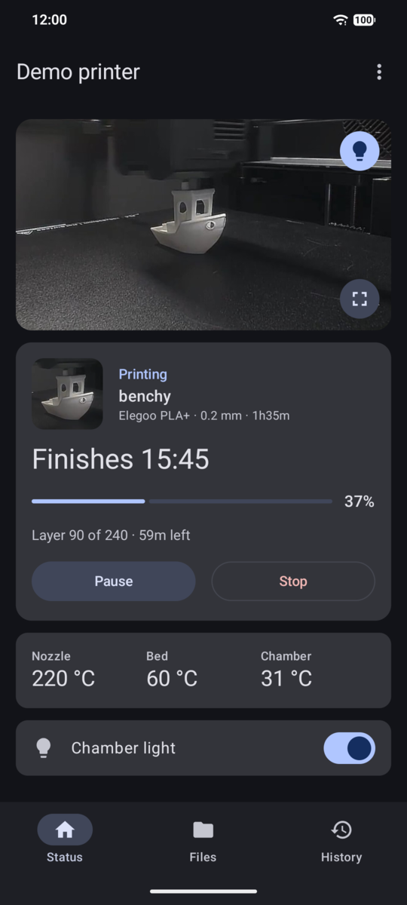
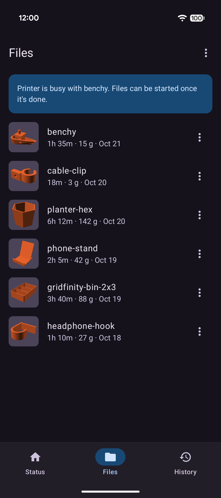
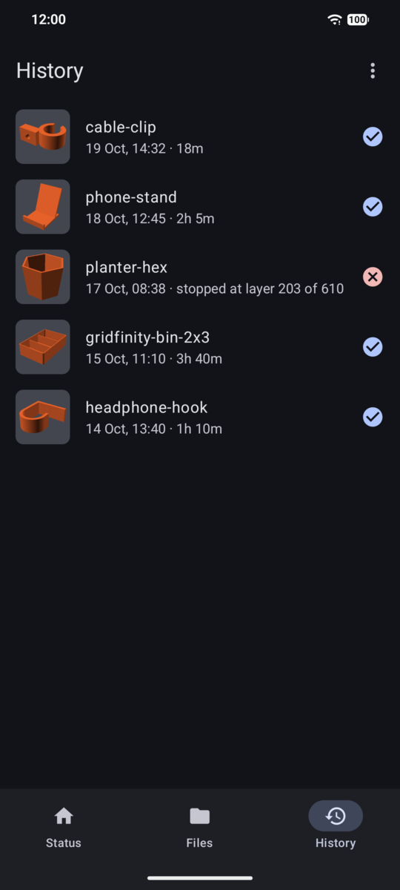
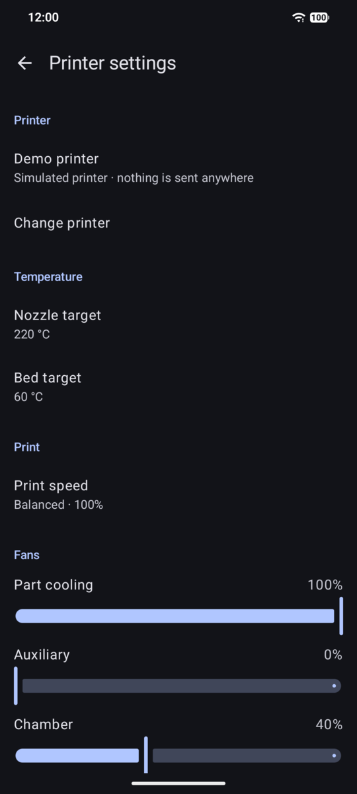

# Centauri

A native Android app to watch and control an **Elegoo Centauri Carbon** 3D printer over your local
network. No cloud, no account, no WebView: the app talks to the printer directly using the same
local protocol (SDCP) the printer's own web interface uses.

> Unofficial app, not affiliated with or endorsed by Elegoo. "Elegoo" and "Centauri Carbon" are
> trademarks of their owner.

| Status | Files | History | Printer settings |
|---|---|---|---|
|  |  |  |  |

Screenshots are from the built-in demo mode, so you can try the app without a printer too.

## Features

- **Live status**: progress, finish time, layer, temperatures, current print's thumbnail
- **Camera**: live view, tap for play/pause, fullscreen landscape, chamber light toggle
- **Control**: pause, resume and stop (with confirmation)
- **Files**: browse the printer's storage, start a print (plate side, auto-leveling, timelapse), delete files
- **History**: past prints with thumbnails, duration and outcome; print again or remove entries
- **Printer settings**: rename the printer, presets (built-in and your own), nozzle/bed targets, print speed, fan speeds, homing
- **Notifications**: ongoing progress while a print runs, plus an alert when it finishes, pauses,
  stops or fails
- **Demo mode**: try every screen with a simulated printer (no hardware needed)
- Follows the system light/dark theme and Material You colours

## Requirements

- Android 8.0 (API 26) or newer
- A Centauri Carbon (the original; the Centauri Carbon 2 uses a different protocol) on the same
  network as the phone. Away from home, a VPN into your network works.

On Android 17 and newer the app asks for **local network access** on first launch; it needs it to
reach the printer.

## Install

Download the APK from [Releases](../../releases) and open it on your phone.

## Build

```sh
./gradlew assembleDebug            # app/build/outputs/apk/debug/app-debug.apk
./gradlew testDebugUnitTest lintDebug
```

Requires JDK 17 or newer and the Android SDK (platform 37). Release builds are unsigned unless a
`keystore.properties` file (not tracked) provides `storeFile`, `storePassword`, `keyAlias` and
`keyPassword`.

## How it works

| What | How |
|---|---|
| Discovery | UDP `M99999` to port 3000 (subnet broadcast, or a typed IP) |
| Status and commands | JSON over a WebSocket on port 3030 |
| Camera | MJPEG over HTTP on port 3031, enabled on demand (the printer has few video slots) |
| Thumbnails | PNGs served by the printer over HTTP |

Command payloads follow the
[elegoo-homeassistant](https://github.com/danielcherubini/elegoo-homeassistant) integration; start
print, file list and file info follow the printer's own web interface.

## License

[MIT](LICENSE)
